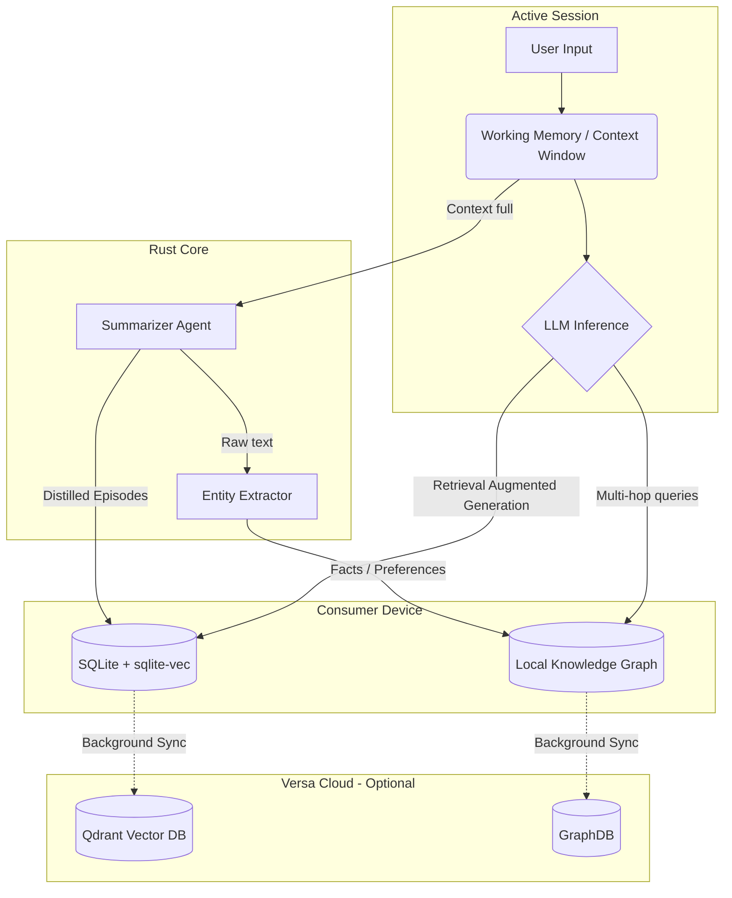

# 06 - Memory Architecture

## 1. Introduction

Memory in an AI Operating System is fundamentally different from traditional OS memory management (RAM/Disk). In Versa OS, memory is the foundation of agentic continuity, personalisation, and reasoning. It dictates how the system learns from the user, recalls past interactions, and builds a worldview. 

Because Versa OS targets consumer-grade hardware across all OS platforms (desktop to mobile) and utilizes a Rust/Tauri v2 core, the memory architecture must be fiercely optimized for limited resources (low RAM, battery constraints) while supporting a hybrid local/cloud model. The local device must hold the most sensitive and frequently accessed data, gracefully failing over to the cloud for heavy computation or deep historical retrieval.

## 2. The Memory Hierarchy

We model Versa's memory on human cognitive architecture, divided into three distinct layers: Working, Episodic, and Semantic Memory.

### 2.1 Working Memory (Short-Term Context)
Working memory is the immediate context window of the active LLM session. It contains the current task definition, recent messages, and immediately relevant retrieved facts.

*   **Implementation:** In-memory Rust structures (e.g., `Vec<Message>`), passed directly to the local inference engine (e.g., Llama.cpp) or cloud API.
*   **Constraints:** Bound by the LLM's context window (e.g., 8k to 128k tokens). 
*   **Eviction:** FIFO with semantic pruning. As the context window fills, older messages are summarized and pushed to Episodic Memory.

### 2.2 Episodic Memory (Experience & History)
Episodic memory stores chronological events: conversations, user actions, system errors, and agent trajectories. It allows the agent to answer questions like, "What did we discuss yesterday about the database schema?"

*   **Implementation:** Local SQLite database with a vector search extension (`sqlite-vec`).
*   **Why `sqlite-vec`?** For consumer hardware (especially mobile), running a standalone vector DB daemon (like Qdrant or Milvus) is too heavy. SQLite is embedded, zero-configuration, and highly performant. `sqlite-vec` allows us to store embeddings directly alongside relational metadata (timestamp, session ID, tool used).
*   **Hybrid Cloud Sync:** Older episodes can be asynchronously synced to a cloud instance (e.g., Qdrant) and removed from local storage to save space.

### 2.3 Semantic Memory (Knowledge Graph & Facts)
Semantic memory contains abstracted knowledge, facts, and user preferences (e.g., "The user prefers Rust over C++", "The user's project is in `C:\Work`"). It is distilled from Episodic Memory.

*   **Implementation:** A local Knowledge Graph (KG) represented via RDF triples or a lightweight graph schema over SQLite, augmented with vector embeddings for semantic search.
*   **Why a Knowledge Graph?** Vectors alone are poor at multi-hop reasoning (e.g., finding the relationship between three distinct entities). A KG provides rigid, deterministic relationships, while embeddings provide fuzzy, semantic matching.

## 3. Storage Infrastructure & Vector Databases

### 3.1 Local Storage: SQLite + `sqlite-vec`

In Tauri v2, the Rust backend handles all filesystem and database operations.

```rust
// Rust Backend: Initializing Episodic Memory with sqlite-vec
use rusqlite::{Connection, Result};
use sqlite_vec::sqlite3_vec_init;

pub struct MemoryManager {
    conn: Connection,
}

impl MemoryManager {
    pub fn new(db_path: &str) -> Result<Self> {
        let conn = Connection::open(db_path)?;
        
        // Load the vector extension
        unsafe {
            let _ = rusqlite::ffi::sqlite3_auto_extension(Some(sqlite3_vec_init));
        }

        // Create hybrid relational + vector table
        conn.execute(
            "CREATE VIRTUAL TABLE IF NOT EXISTS episodic_memory USING vec0(
                embedding float[768],
                content TEXT,
                timestamp DATETIME DEFAULT CURRENT_TIMESTAMP,
                session_id TEXT
            )",
            [],
        )?;

        Ok(Self { conn })
    }

    pub fn insert_episode(&self, embedding: &[f32], content: &str, session_id: &str) -> Result<()> {
        // Implementation for inserting a vector and metadata
        // ...
        Ok(())
    }
}
```

### 3.2 Cloud Tier: Qdrant

For the hybrid cloud tier, Qdrant is selected due to its Rust-native architecture, gRPC performance, and advanced filtering capabilities. When the user connects multiple devices (phone, laptop), the cloud Qdrant instance acts as the central synchronization hub for Semantic and deep Episodic memory.

## 4. Architecture Diagram



## 5. Eviction & Compression Policies

Given the constraints of consumer hardware, memory cannot grow infinitely.

### 5.1 Working Memory Compression
Instead of simple truncation, Versa OS uses a **Rolling Summary Eviction**:
1. When context reaches 80% capacity, the oldest 30% of messages are selected.
2. A fast, local LLM (e.g., Llama 3.1/3.2 8B-class or Qwen3 8B-class quantized) generates a dense summary of these messages.
3. The summary replaces the original messages in the context window.
4. The raw messages are embedded and flushed to Episodic Memory.

### 5.2 Local Storage Eviction (Tiering)
For local SQLite storage, we employ an **LRU (Least Recently Used) with Semantic Importance** policy.
*   **Scoring:** Every memory chunk has a score: $Score = (Frequency \times Weight) - Decay$.
*   Important semantic facts (e.g., User's name, core system instructions) have an user-pinned retention policy.
*   Transient episodes (e.g., "Set a timer for 5 minutes") decay rapidly.
*   When local storage exceeds the user-defined quota (e.g., 2GB), low-score items are purged locally and offloaded to the cloud (if enabled).

```python
# Python pseudo-code for Eviction Scoring
import datetime

def calculate_memory_score(memory_item, current_time):
    # Base weight assigned during extraction (e.g., User Pref = 1.0, Chit-chat = 0.1)
    base_weight = memory_item.weight 
    
    # Time decay
    age_days = (current_time - memory_item.timestamp).days
    decay_factor = 0.95 ** age_days # 5% decay per day
    
    # Retrieval frequency
    frequency_boost = math.log1p(memory_item.access_count)
    
    return base_weight * frequency_boost * decay_factor
```

