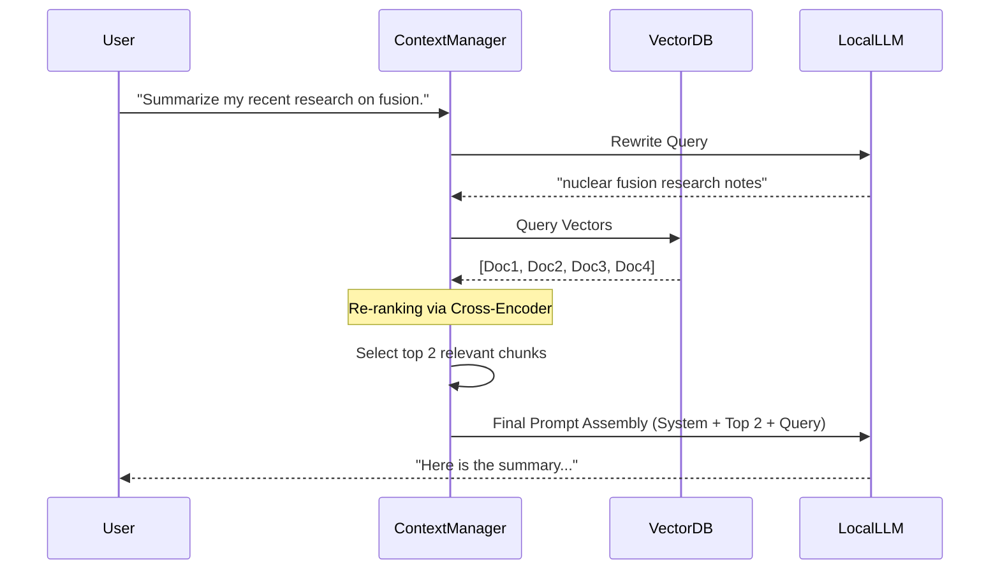

# 07 - Context Management & RAG

## 1. Introduction

Context Management is the art of curating exactly what the LLM "sees" at any given moment. In a hybrid AI Operating System like Versa OS, the context window is the most precious resource. Sending too much data increases latency, burns battery, incurs cloud API costs, and degrades the LLM's reasoning due to the "lost in the middle" phenomenon. 

This document details how Versa OS dynamically manages the context window, engineers system prompts on the fly, and implements advanced Retrieval-Augmented Generation (RAG) strategies.

## 2. Context Window Management Architecture

The context window in Versa OS is not a static text buffer. It is a dynamically assembled, weighted tree of information blocks.

### 2.1 The Context Assembly Pipeline

Before an inference request is dispatched, the Context Manager (running in the Rust core) assembles the prompt through a strict hierarchy:

1.  **System Directives (Highest Priority):** Core OS instructions, safety boundaries, and current active Persona.
2.  **Immediate User Intent:** The latest query or command.
3.  **Working Memory (Dialogue History):** Recent conversational turns.
4.  **Semantic Context (RAG):** Retrieved facts from the Knowledge Graph.
5.  **Episodic Context (RAG):** Retrieved past interactions from Vector Storage.
6.  **Environmental Context:** Screen state, active application, OS clipboard, time, and location.

### 2.2 Dynamic Context Compression

To fit all this into a finite window (e.g., 8k tokens for a local model, 128k for a cloud model), Versa uses a **Budget Allocation Algorithm**.

```rust
// Rust: Dynamic Context Budgeting
pub struct ContextBudget {
    pub total_tokens: usize,
    pub system_tokens: usize,
    pub user_tokens: usize,
    pub memory_tokens: usize, // History
    pub retrieval_tokens: usize, // RAG
}

impl ContextBudget {
    pub fn allocate(max_tokens: usize, query_complexity: f32) -> Self {
        // System prompt is fixed
        let system_tokens = 1000; 
        let remaining = max_tokens - system_tokens;

        // Dynamic allocation based on query complexity
        // High complexity = more RAG needed; Low complexity = more dialogue history
        let retrieval_ratio = if query_complexity > 0.7 { 0.6 } else { 0.3 };
        
        Self {
            total_tokens: max_tokens,
            system_tokens,
            retrieval_tokens: (remaining as f32 * retrieval_ratio) as usize,
            memory_tokens: (remaining as f32 * (0.9 - retrieval_ratio)) as usize,
            user_tokens: (remaining as f32 * 0.1) as usize,
        }
    }
}
```

## 3. Advanced RAG Strategies

Standard RAG (embed query -> cosine similarity -> inject top-K) is insufficient for an OS-level agent. It fails at temporal reasoning and structural logic. Versa OS uses **Hybrid Graph-Vector RAG**.

### 3.1 Query Routing & Rewriting
When the user asks, "What did I say about the marketing budget last week?", the raw query is poor for vector search.
1.  **Rewrite:** A lightweight local model rewrites the query: `"marketing budget discussion", date >= (current_date - 7)`.
2.  **Route:** The Router determines if this requires Vector Search (semantic match), Graph Search (relational match), or SQL Query (structured metadata).

### 3.2 Graph-Vector RAG (Knowledge Graph + Embeddings)
We use a Knowledge Graph to anchor the context. 
*   **Vector Search** finds the node `Marketing_Budget_Q3`.
*   **Graph Traversal** retrieves adjacent nodes (e.g., `Approved_By: Alice`, `Linked_File: budget.xlsx`).
*   This structured subgraph is serialized into markdown and injected into the context.

### 3.3 Contextual Snippet Injection
To prevent context pollution, retrieved documents are not injected blindly.



## 4. Prompt Engineering at the OS Level

In Versa, the "System Prompt" is a living document, heavily templated using Liquid/Jinja-style syntax evaluated in Rust before inference.

```markdown
<!-- OS Dynamic Prompt Template -->
<system_directives>
You are Versa, an autonomous OS agent.
Current OS: {{ os_name }} ({{ battery_level }}%)
Current Active App: {{ active_window_title }}
</system_directives>

<user_preferences>
{{ retrieved_semantic_preferences }}
</user_preferences>

<retrieved_context>

- Source: {{ chunk.source }} ({{ chunk.timestamp }})
  Content: {{ chunk.text }}

</retrieved_context>

<working_memory>
{{ dialogue_history }}
</working_memory>
```

**Why this matters:** By rendering the prompt dynamically on the client, the cloud LLM (if used) remains stateless, ensuring privacy. The local device acts as the policy-controlled aggregation point for context, with hardware-backed protection used where the platform supports it.


