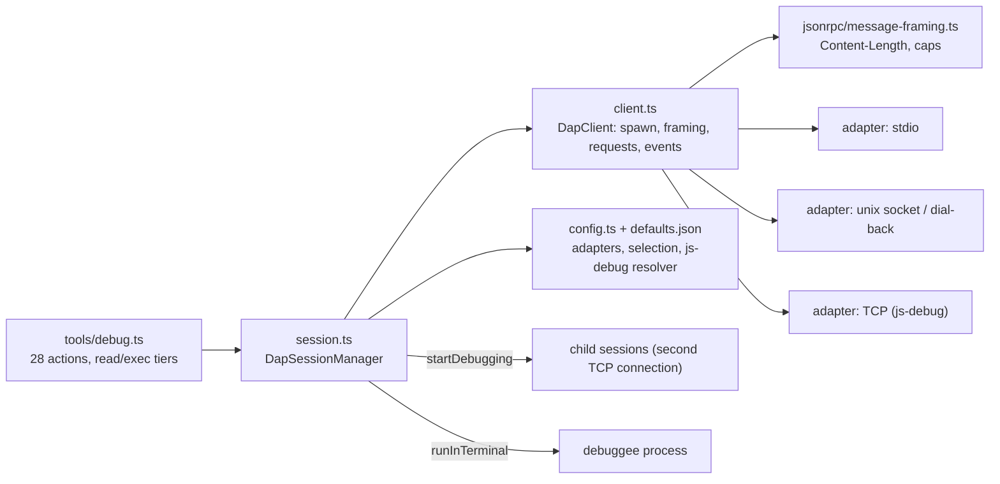

# C4 level 3: debugger (DAP) components, omp versus Vivianne

omp source: `packages/coding-agent/src/dap/` (`client.ts` 1,060, `session.ts` 1,877, `config.ts` 418, `types.ts` 615, `defaults.json`), the tool `tools/debug.ts` (986), and `debug/` plus `packages/tui/src/apps/debug/`, which are tools for debugging omp itself and are **not** part of the model-facing debugger. Vivianne has no debugger.

Line references are in `docs/omp-dap-map.md`. Nothing was run: items marked "by reading" there are not confirmed.

## Component diagram (omp)

## Components and what to do with each

| omp component | Single responsibility | Port action for Vivianne |
|---|---|---|
| `client.ts` | Spawn an adapter in stdio, socket or TCP mode; frame messages; match responses to requests; reverse requests (`runInTerminal`, `startDebugging`); dispose with a kill | New `dap/client.rs`. Share the strict framer with `lsp/client.rs` (extract a small `jsonrpc_stdio` module: both use `Content-Length`, a 16 KiB header cap and a body cap). Stdio first, TCP and dial-back second, no unix socket on Windows |
| `session.ts` | The session manager: launch and attach handshake, breakpoint sync, event-driven state, waiting for a stop, child sessions, teardown, idle cleanup | New `dap/session.rs`. Key sessions by Vivianne thread id, not process-wide. Fix the ordering defect below |
| `config.ts`, `defaults.json` | 14 adapters; selection by file type, root marker and rank; js-debug server discovery; user overrides merged field by field | New `dap/config.rs` with the same shape. Correct the defects below before copying any entry |
| `tools/debug.ts` | The tool: 28 actions, each mapped to DAP requests, with a capability gate and a tier (read or exec) | New `agent/tools/debug.rs`, split by risk (see below) |
| `debug/` (profiler, remote debugger, report bundle, system info) and the TUI debug app | Diagnostics for omp itself | **Out of scope.** Vivianne already has a harness debug trace (`cmd_harness_trace`) and a log |

## The 28 actions, grouped

| Group | Actions | DAP requests | Tier |
|---|---|---|---|
| Start and stop | `launch`, `attach`, `terminate`, `sessions` | `initialize`, `launch`/`attach`, `configurationDone`, `terminate`, `disconnect` | exec (`sessions` read) |
| Breakpoints | `set_breakpoint`, `remove_breakpoint`, `set_instruction_breakpoint`, `remove_instruction_breakpoint`, `data_breakpoint_info`, `set_data_breakpoint`, `remove_data_breakpoint` | `setBreakpoints` (the full list per file each time), `setFunctionBreakpoints`, `setInstructionBreakpoints`, `dataBreakpointInfo`, `setDataBreakpoints` | exec |
| Run control | `continue`, `step_over`, `step_in`, `step_out`, `pause` | `continue`, `next`, `stepIn`, `stepOut`, `pause` | exec |
| Inspect | `stack_trace`, `threads`, `scopes`, `variables`, `evaluate`, `output` | `stackTrace`, `threads`, `scopes`, `variables`, `evaluate` | read (`evaluate` is exec: it can run code in the program) |
| Low level | `disassemble`, `read_memory`, `write_memory`, `modules`, `loaded_sources`, `custom_request` | `disassemble`, `readMemory`, `writeMemory`, `modules`, `loadedSources`, any | read, except `write_memory` and `custom_request` which are exec |

Missing from omp, and worth adding on top: exception breakpoints and `exceptionInfo`, `setVariable`, `restart`, `goto`, `completions`, variable paging, log points and hit conditions on source breakpoints, step granularity, and handling of the `breakpoint`, `thread`, `invalidated` and `capabilities` events.

## Defects in omp not to copy

Confirmed by reading unless marked otherwise:

1. **Breakpoint order.** For a root session omp sends `configurationDone` before the agent can set any breakpoint, so a program with no stop-on-entry can run past them. The DAP order is `initialize`, `launch`/`attach`, wait for `initialized`, set breakpoints, then `configurationDone`. Vivianne should accept an initial set of breakpoints in `launch` and send them before `configurationDone`.
2. **Repo-controlled commands.** Adapter definitions come from `dap.json`/`.omp/dap.yaml` in the project with no trust check, and a repo-local binary beats the one on PATH. The approval shows only `Program:`. A cloned repo can therefore make a launch run a binary of its choosing without the user seeing it.
3. **Adapter-started processes.** `runInTerminal` and `startDebugging` run with no approval beyond the first `launch`, and omp keeps no handle on a debuggee it started, so it is never killed.
4. **Environment.** Adapters and debuggees inherit the full environment; a `null` value in an adapter's env is dropped instead of unsetting the variable (a spec deviation).
5. **Timeouts and waiting.** A timed-out `continue` or step probably throws through the tool although the documentation says it returns "still running" (by reading, unverified). `pause` always prints "paused" and does not fetch the top frame, so `scopes` then fails.
6. **State.** One debug session for the whole process. Breakpoint verification comes only from the `setBreakpoints` response, so lazily verified breakpoints stay "pending". Stale thread ids are reused.
7. **Cleanup.** A 10 minute idle timer kills an adapter without `disconnect`, which can kill a long-running debuggee between tool calls; there is no hook on exit, so adapters can outlive omp.
8. **Output.** Only `output` is capped (128 KiB); `evaluate`, `variables`, `stack_trace` and dumps are not.
9. **Config.** `codelldb` (`--port 0` with stdio) and `rdbg` (`--open`) look misconfigured; an empty argument is dropped from the Flutter adapter; user `args` overrides are ignored for js-debug.
10. **Windows.** `/tmp` is hard-coded, unix sockets are never unlinked, and the unix-socket tests return early off Linux.

Adapter behaviour (which argv really works) is from reading `defaults.json`, not from running the adapters.
