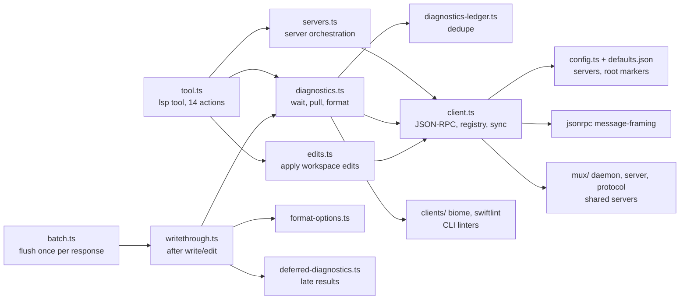

# C4 level 3: LSP components, omp versus Vivianne

omp source: `packages/coding-agent/src/lsp/` (TypeScript, about 9,300 lines). Vivianne: `packages/gui/src-tauri/src/lsp/` (`client.rs` 413, `manager.rs` 194, `mod.rs` 168, `uri.rs` 135) and `agent/tools/lsp_nav.rs` (149), with diagnostics surfaced after edits from `agent/tools/builtin.rs` and `files/apply_patch.rs` through `lsp::manager::post_edit_block`.

Line references and the evidence for each row are in `docs/omp-lsp-map.md`.

## Component diagram (omp)

## Components and what to do with each

| omp component | Single responsibility | Vivianne today | Port action |
|---|---|---|---|
| `client.ts` (2,607 lines) | JSON-RPC over stdio, client registry, document sync, server-initiated requests, writes with timeouts, crash handling | `lsp/client.rs`: strict framing with size caps, diagnostics map, 15 s request timeout, 40 open documents, lazy sync | **Keep and extend.** Add: a write queue with a per-write bound; `$/cancelRequest`; handlers for `workspace/configuration` (look up dotted sections properly: omp's looks up only the exact top-level key), `client/registerCapability`, `window/workDoneProgress/create`, `workspace/applyEdit`; a 3 minute negative cache for a server that failed to start; registry key by command, cwd, args and init options |
| `types.ts` | Wire types | `lsp/mod.rs` has the few it needs | Add types as the operations that need them arrive; keep `serde_json::Value` for the long tail |
| `config.ts`, `defaults.json` | Which server for which file; root markers; binary resolution | `mod.rs::server_candidates` (a short table) | Extend the table to omp's list (it has many servers); add root-marker detection; resolve binaries from PATH only unless the user trusts the project (see the plan's safety section) |
| `servers.ts` | Start and warm servers, status | `manager.rs` (max 3 servers, 10 minute idle close) | Add `status` and `reload`; optional warm-up for the project's main language |
| `diagnostics.ts` | Wait for a fresh report; push and pull; version-aware acceptance (a 250 ms settle window for push-only servers); "unreported" is not "clean" | `manager::report` returns Published or NotReported with a wait | **Biggest gain.** Make acceptance version-aware, add `textDocument/diagnostic` pull, keep the unreported versus clean split Vivianne already has |
| `diagnostics-ledger.ts` | Do not repeat a message the agent already saw (identity is the message without its `path:line:col` prefix) | None | Port as is: small and useful |
| `deferred-diagnostics.ts`, `writethrough.ts` | Wait 500 ms inline after a write, then hand off to a deferred channel (12 s) and deliver a late result as a notice; each write commits to disk even if the LSP step fails | `post_edit_block` waits and appends | Port the inline-then-deferred shape. The notice needs a route into the thread: use the existing system-message path used for thread messages, and check staleness with a per-file version |
| `batch.ts` | Run post-edit LSP work once per model response, not once per tool call | Per call | Needed if Vivianne runs edits in parallel; otherwise skip |
| `edits.ts` | Apply workspace edits (rename, code actions, formatting) to disk, including file operations | None (read-only tool) | Port: needed for `rename`, `code_actions`, format-on-write |
| `format-options.ts` | Pick tab and indent options: editorconfig, then content sniffing, then 2 spaces | None | Port with the `ignore`/`editorconfig` approach; small |
| `tool.ts` (1,647 lines) | The `lsp` tool: 14 actions, per-call budget, output shaping | `lsp_nav.rs`: 4 read actions, caps of 100 locations and 16,000 characters | Grow to the 14 actions (see below) and **split by risk** |
| `workspace-diagnostics.ts` | `file: "*"`: run project checkers by root marker (not LSP) | `diagnostics` tool is per file | Optional; a "check the project" action using `cargo check`, `tsc`, and similar, through the existing sandboxed command runner |
| `clients/` (biome, swiftlint) | CLI linters beside LSP | None | Optional, last |
| `mux/`, `lspmux.ts` | Share one server across sessions; rust-analyzer wrapper | None | **Do not port.** Vivianne is one process; see `c4-container.md` |

## The 14 operations

omp: `diagnostics`, `definition`, `type_definition`, `implementation`, `references`, `hover`, `symbols`, `rename`, `rename_file`, `code_actions`, `status`, `reload`, `capabilities`, `request` (raw).
Vivianne has: `definition`, `references`, `implementation`, `hover`, plus a separate `diagnostics` tool.

Because Vivianne's permission gate decides per **tool name** (not per argument), the new operations go in two tools:

- `lsp` (read, allowed in plan mode): `diagnostics`, `definition`, `type_definition`, `implementation`, `references`, `hover`, `symbols`, `status`, `capabilities`.
- `lsp_edit` (changes files, gated and refused in plan mode): `rename`, `rename_file`, `code_actions` (the ones that apply), `reload`, and raw `request`.

## Caps and limits worth keeping (omp's values)

50 messages per diagnostics result, 20 glob targets, 50 references with context, 200 workspace symbols, 1,000 files in a rename; timeouts of `max(20, requestTimeout)` per call, 5 to 300 seconds when explicit. Vivianne's existing 100 locations and 16,000 characters stay as the output ceiling.

## What not to copy

- Always sending full text on `didChange` is simple and correct but wasteful on big files: Vivianne's current sync is the same; leave it until a measurement says otherwise.
- omp's `LspLinterClient` is unreachable in its shipped config, `clearLinterClientCache` has no callers, and the `biome lsp-proxy` args are dead (all noted in the map).
- omp's `diagnostics` action does not apply its own 50-message cap, and `biome format()` writes to disk outside the write-through. Do not reproduce either.
