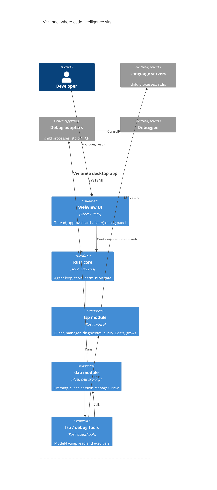

# C4 level 2: containers

## omp today (as read)

| Container | Process | Transport | Notes |
|---|---|---|---|
| omp host | The Bun process | In-process | Holds the LSP client registry and the DAP session manager (a module singleton: one debug session for the whole process) |
| Language server | Child process spawned per (command, cwd, args, init options, settings, language) | LSP over stdio, `Content-Length` framing | Crash removes it and the next call respawns it; a failed start is cached as negative for 3 minutes; idle reaping is off by default |
| LSP mux daemon | One per project, started through a broker | Local IPC endpoint (Rust `IpcServer` in `pi-natives`) | Shares one server across sessions, lingers 5 minutes, replays diagnostics to new sessions. Anything that can reach its socket can make it spawn a command (permissions are the only guard, not verified) |
| Debug adapter, stdio | Child, detached into its own process group | DAP over stdin/stdout | The default |
| Debug adapter, socket or TCP | Child | A unix socket on Linux; omp listens and the adapter dials back on other systems (delve); a reserved port plus a stdout "listening" gate for js-debug | A second TCP connection is made for each child session js-debug asks for |
| Debuggee | Started by the adapter, or by omp itself when the adapter sends `runInTerminal` | Its stdout is drained into a 128 KiB buffer | omp keeps no handle to a process it started for the adapter, and never kills it |
| Linter | CLI run on write | Command line | biome, swiftlint |

## Vivianne target

Vivianne's containers are the app process plus child processes. No daemon, no shared socket, no second app. Decisions that follow from that:

- **One adapter or server per Vivianne thread** (omp's process-wide debug singleton would let two threads corrupt each other's session). The key is the thread id, as the harness layer already does for coding agents.
- **No mux.** Vivianne already caps at 3 servers and closes idle ones. A mux is the largest and riskiest part of omp's LSP, for a benefit (sharing one rust-analyzer between processes) Vivianne does not have because it is one process.
- **Process cleanup is Vivianne's existing machinery**: `own_group`, `TreeKillOnDrop` and `kill_tree` for the adapter's whole tree, `crate::proc::quiet` so no console windows flash on Windows, and a hook on app exit (omp has none, so its adapters can outlive it).
- **Windows needs its own answer** for omp's unix-socket mode (delve): use the TCP dial-back path omp already has for non-Linux systems.
