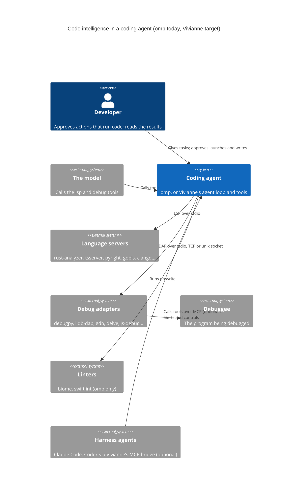

# C4 level 1: context. Code intelligence (LSP and debugger) in oh-my-pi, and where it lands in Vivianne

Scope: the LSP and debugger (DAP) modules of oh-my-pi ("omp"), as read from the clone at `Project Versa/oh-my-pi-breakdown`, and the same two capabilities in Vivianne. Full detail is in `docs/omp-lsp-map.md` and `docs/omp-dap-map.md` (file and line references). The C4 skill's whole-repository walk was not run: this is the same method (context, container, component, code-level notes) scoped to these two modules.

Confidence: both maps were produced by reading the code. Nothing in omp was built or run, so behaviour claims marked "by reading" are not confirmed by execution.

## System in one sentence

A coding agent gains code intelligence from two kinds of child process: **language servers** (what a symbol means, what is wrong) and **debug adapters** (what the program is doing while it runs), each driven through a model-facing tool whose results are shaped, capped and approval-gated.

## Who uses it

| Who | Type | What they need | Through |
|---|---|---|---|
| The model (omp's agent, Vivianne's agent) | Programmatic user | Find definitions and references, see compile errors right after an edit, step through a failing program | The `lsp` and `debug` tools |
| The developer | Human user | Trust that edits are checked, approve anything that runs code, see what the agent is debugging | Approval cards, the thread, (omp) a `/debug` menu |
| A harness agent running inside Vivianne (Claude Code, Codex) | Programmatic user | The same code intelligence Vivianne's own agent has | Vivianne's MCP bridge (see `docs/acp-claude-port-plan.md`, Phase 6), optional |

## External systems

| System | Type | Used for | How |
|---|---|---|---|
| Language servers (rust-analyzer, typescript-language-server, pyright, gopls, clangd, and many more) | Child processes | Diagnostics, navigation, rename, code actions, formatting | LSP over stdio, `Content-Length` framing |
| Linters (biome, swiftlint) | CLI programs | Lint on write, outside LSP | Run as commands (omp only) |
| Debug adapters (debugpy, lldb-dap, gdb, delve, js-debug, codelldb, netcoredbg and others; omp lists 14) | Child processes | Launch, attach, breakpoints, stepping, inspection | DAP over stdio, a TCP port, or a unix socket |
| The debuggee | A program the adapter starts | The thing being debugged | Started by the adapter, or by the client when the adapter asks (`runInTerminal`) |
| lspmux (third party) and omp's own LSP mux daemon | Shared server daemons | Share one language server across sessions | omp only; Vivianne has no need yet |

## Context diagram

## What each side has today

| | omp | Vivianne |
|---|---|---|
| LSP | About 9,300 lines of TypeScript: 14 actions, push and pull diagnostics with version-aware acceptance, deferred late diagnostics, a ledger, write-through with formatting, workspace edits (rename, code actions), a shared-server mux, config for many servers | About 1,000 lines of Rust: lazy spawn per language, diagnostics after edit, 4 read-only operations (definition, references, implementation, hover), a cap of 3 servers, 10 minute idle close |
| Debugger | A 28-action `debug` tool over a DAP client and session manager (about 4,000 lines of TypeScript), 14 adapters, child sessions, plus a TUI debug app and self-diagnostics | None |
| Language | TypeScript on Bun. The Rust crates provide only glob, IPC and process helpers. **No LSP or DAP protocol code is in Rust**, so nothing can be copied across: it is a port | Rust (Tauri) |

## Related

- Containers: `c4-container.md`
- Components: `c4-component-lsp.md`, `c4-component-dap.md`
- Implementation plan: `implementation-plan.md`
